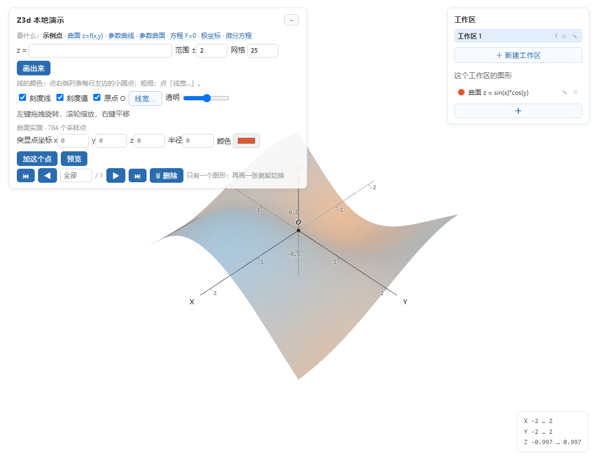
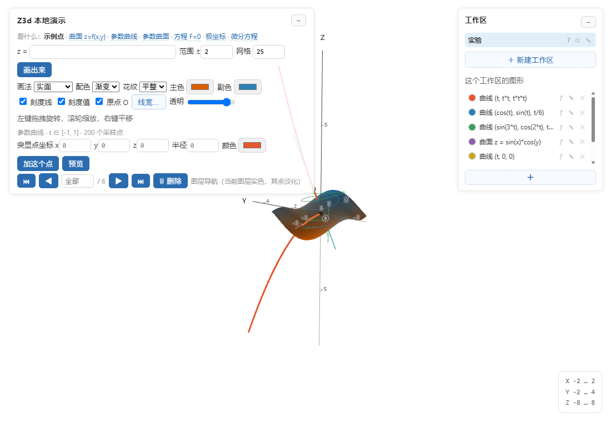

# Z3d 三维函数绘图

一个跑在浏览器里的三维数学绘图器：输入函数或方程，立刻得到可旋转、可缩放的立体图。纯静态网页，单文件，无后端、无依赖、无构建步骤。

**在线使用：** https://daaimozun.github.io/z3d/


## 它能画什么

| 类型 | 输入 | 例子 |
| --- | --- | --- |
| 曲面 z = f(x, y) | 一个二元表达式 | `x^2 - y^2`、`sin(x)*cos(y)` |
| 参数曲线 x(t), y(t), z(t) | 三个一元表达式 | `cos(t)`、`sin(t)`、`t/6` |
| 参数曲面 x(u,v), y(u,v), z(u,v) | 三个二元表达式 | 圆环面、球、莫比乌斯带 |
| 隐式方程 F = 0 | 一个三元方程 | `x^2+y^2+z^2=1`、`x+2*y+3*z=6` |
| 极坐标 r = f(t) | 一个表达式 | 心形线 `1+cos(t)`、玫瑰线 `sin(3*t)` |
| 微分方程 | 三个变化率 + 初值 | 洛伦兹吸引子、阻尼振子 |
| 标记点 | 坐标 + 半径 + 名字 | 标出切点、交点、极值点 |

曲面用 marching tetrahedra 生成，微分方程用四阶 Runge–Kutta 数值求解。

## 特点

- **Z 轴朝上**，符合数学课本习惯；带 X/Y/Z 轴标、原点 O、可关的刻度线和刻度值
- **多工作区 + 多图层**：一个工作区放多张图，逐层换色、设线宽、设透明度
- **配色与花纹**：渐变 / 单色 / 双色；平整 / 方格 / 菱形 / 条纹
- **方程标注**：图层上的 ƒ 按钮可把该图方程直接标在图上
- **刻度可控**：自动或手动，间隔填 1 就是 1、2、3、4；起点可对齐到标记点
- **表达式容错**：`2x` 自动补乘号，`x^2` 当乘方，`pi`、`e` 直接可用，中文括号也能识别
- **整张图可分享**：所有参数都在 URL 里，发个链接对方看到的就是同一张图
- **手机可用**：窄屏自动改布局，可添加到主屏当 App 用




## 使用

不需要安装。打开 `index.html`，或者在浏览器里访问上面那个网址。

想在自己电脑上跑：

```bash
git clone https://github.com/<你的用户名>/<仓库名>.git
cd <仓库名>
# 直接双击 index.html 即可；或起个本地服务
python -m http.server 8000
```

### 表达式写法

| 写法 | 含义 |
| --- | --- |
| `x*y` | 乘法（一个星号） |
| `x**2` 或 `x^2` | 次方（两个星号，或脱字符） |
| `2x`、`x(1-x)`、`(x+1)(x-1)` | 省略的乘号会自动补上 |
| `sin cos tan asin acos atan sinh cosh tanh` | 三角函数 |
| `sqrt exp log abs floor ceil pow min max` | 其他常用函数 |
| `pi`、`e` | 圆周率、自然常数 |

## 文档

- [零基础使用说明](docs/Z3d-使用说明.pdf) — 从建工作区到调颜色，一步步来
- [演示图册](docs/Z3d-演示图册.pdf) — 七种类型的实例，每张都附复现参数

## 测量面积与体积

选中某一层（或直接点「测量」量最后一层），会给出长度 / 面积 / 体积，以及一个误差估计：

```
曲面面积 ≈ 12.567  ± 4.5e-2   网格 30/60
围成体积 ≈ 4.189   ± 2.7e-2   网格 30/60
```

精度策略按类型分开，不假装都一样准：

| 类型 | 方法 | 实际精度 |
| --- | --- | --- |
| 曲线弧长 / 极坐标 | 一维复合 Gauss + Richardson | 10 位以上有效数字 |
| 曲面 z=f(x,y) 下的体积 | 矩形域自适应二维积分 | 10 位以上（光滑时） |
| 曲面面积 | 自适应积分 ∬√(1+fₓ²+f_y²) | 约 6 位（面积里用了数值导数） |
| 参数曲面面积 / 闭合体积 | 自适应积分 ∬|r_u×r_v|、散度定理 | 约 6 位 |
| 隐式方程围成的体 | 四面体网格 + 两档网格外推 | 3–4 位，随网格加密收敛 |

几点如实说明：

- 隐式体的体积只能估算——三维里网格加密的代价是 O(h³)，永远拿不到「精确」。
- 表面有尖角、竖直切线、奇点时，误差条会明显变宽，这是诚实的信号，不要忽略它。
- 开放、自交的曲面没有确定的「围成体积」，结果仅供参考。

## 保存与导出

- **存图**：把当前画面导成 PNG
- **存数据**：把所有工作区导出成 JSON
- **复制链接**：当前这张图的参数全在地址里，发链接对方打开就是同一张图
## 部署

仓库根目录就是站点根目录，以下平台可直接用：

| 平台 | 做法 |
| --- | --- |
| GitHub Pages | Settings → Pages → Source 选 `main` / `(root)` |
| Netlify / Vercel | 同上，拖整个文件夹或 
px vercel --prod |
| Vercel | `npx vercel --prod` |
| 任意静态托管 | 上传全部文件即可 |

仓库里附了 `netlify.toml`、`vercel.json`、`.nojekyll`，已经配好。

## 目录结构

```
index.html              主程序（three.js 已内联，单文件 600 KB）
manifest.webmanifest    可添加到主屏（PWA）
icon-192.png / icon-512.png / apple-touch-icon.png
og.png                  社交分享缩略图
404.html                兜底页
docs/                   使用说明、演示图册、截图
```

## 技术说明

- 坐标轴、投影标签、相机与交互自建，数学 Z 轴朝上（three.js 默认 Y 轴朝上，场景整体旋转 −90°）
- 隐式曲面用 marching tetrahedra：把每个立方体拆成 6 个四面体，按符号变化取交点，不需要 256 项的查表
- 面颜色手工着色（不用光照），避免 three.js r67 双面材质过曝
- 渲染使用 [three.js](https://threejs.org/) r67（内联），因为依赖 `THREE.Geometry`、`TextGeometry` 等后续版本已移除的接口
- 最初的坐标系与渲染思路来自 [NathanEpstein/Z3d](https://github.com/NathanEpstein/Z3d)（该仓库未附许可证，仅作参考致谢）

## 许可证

本项目代码采用 MIT 许可证，见 [LICENSE](LICENSE)。
内联的 three.js 遵循其自身的 MIT 许可证。
